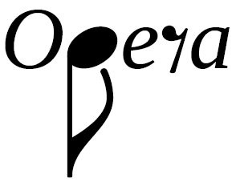
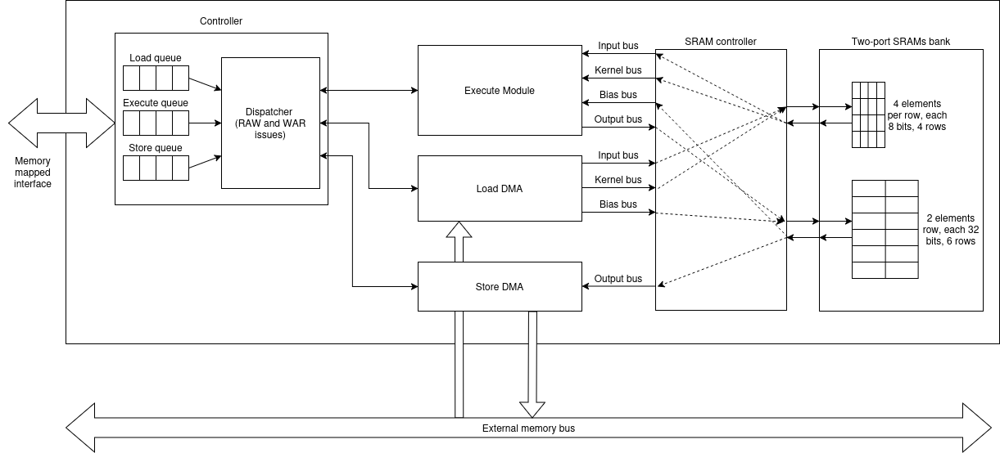
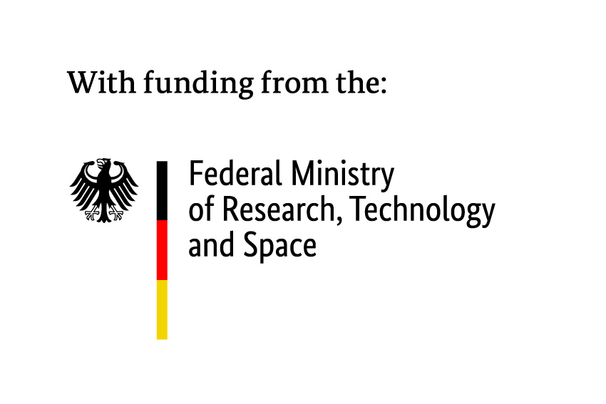

  

# OPERA: Open Platform for Extensible Robust Acceleration - HW generator

*NOTE:* this is the initial implementation for OPERA's HW generator from paper "OPERA: Towards an Open Platform for Extensible Robust Accelerators" presented at [LATTE '26](https://capra.cs.cornell.edu/latte26/).

## Table of contents

* [Description](#description)
* [Architecture](#architecture)
* [Using OPERA](#using-opera)
    * [Chipyard integration](#chipyard-integration)
    * [Standalone](#standalone)
* [Customizing OPERA](#customizing-opera)
* [Running tests](#running-tests)

## Description

OPERA is not only an accelerator: it is a tool to build accelerators for AI. Our vision is to provide a **full end-to-end** flexible platform which includes both hardware *and* software.

Our goal is to provide an *open* ecosystem to build and compare different kinds of accelerators in a reproducible manner. Do you want to build an accelerator supporting both Output Stationary and Weight Stationary dataflows? You can do so with OPERA. Do you want to have different SRAMs for weights and activations, even with different bit widths for each one of them? We have you covered. You don't like or don't want to learn Chisel, have already a really interesting implementation of a computation unit written in Verilog, but don't want to implement all the data movement shenanigans around it? You can integrate your Verilog code directly in OPERA and use our infrastructure to rapidly build and test your accelerator.

## Architecture

  

## Using OPERA

### Chipyard integration

The easier way of using OPERA is to take advantage of its integration with the Chipyard ecosystem. **Example on how to integrate with Chipyard will be added in the future.**

### Standalone

The main way of using OPERA is with Chipyard, but that doesn't mean you can't generate the Verilog standalone for integration as a separate IP into other workflows. In order to do so, you need to export the following environment variable:

    export OPERA_STANDALONE=1

Now, you can export the SystemVerilog running:

    mill OPERA.runMain opera.SystemVerilog --target-dir generated-src

## Customizing OPERA

If you don't intend on adding new features, and just want to build accelerators using the already available classes, you can do so using the [OperaConfigs](src/main/scala/accelerator/Config.scala) class. See OPERAConfigs.defaultConfig for an explanation on how to configure it. 

## Running tests

    export OPERA_STANDALONE=1
    ./mill OPERA.test

If you want to execute a specific test, you can use:

    ./mill OPERA.test.testOnly opera.test.<spec name>

Note: If it fails, it may be because the 'out' folder already exists. Delete the folder and try again.

## License

This program is licensed under the [Apache License 2.0](./LICENSE).

## Acknowledgment

Development of this program was partially funded by the German Federal Ministry
of Research, Technology, and Space (BMFTR) within the ChipsJU project RIGOLETTO
(project number 101194371, grant number 16MEE0547).